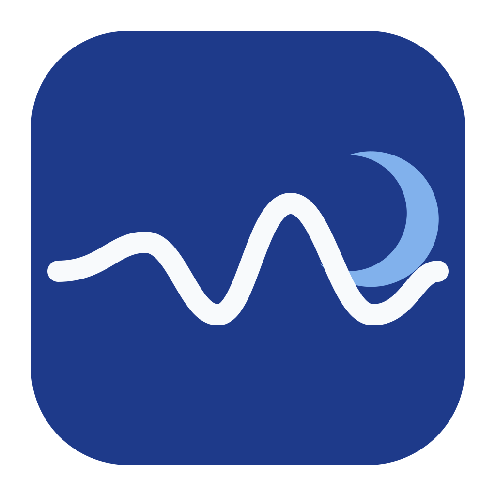

<div align="center">
  
  <h1>Soundly</h1>
  <p>소리를 담고, 다시 듣는 가장 자연스러운 흐름.</p>
  <p>Kotlin | Jetpack Compose | Navigation 3 | Coroutines Flow</p>
</div>

---

Soundly는 Android 음성 녹음 앱과 오디오 SDK입니다. 마이크나 파일에서 소리를 수집하고, 원하는 출력으로 기록합니다. 녹음과 재생은 Flow를 수집할 때 시작하며, 수집 범위 안에서 자원을 정리합니다.

## 앱에서 할 수 있는 일

- FLAC 또는 WAV로 녹음하고 일시정지, 재개, 저장하기
- 화면을 이동해도 포그라운드 서비스에서 녹음 이어가기
- 녹음 목록 검색과 파일 삭제하기
- 재생 위치 탐색과 10초 단위 이동하기

Compose로 구성한 화면은 edge-to-edge를 적용합니다. 화면 탐색은 Navigation 3의 저장 가능한 스택을 사용하고, 재생 패널은 위치를 별도로 관찰해 목록 전체의 갱신을 줄입니다.

## 녹음 시작하기

입력과 출력을 선택한 뒤 Flow를 수집합니다. 파일 출력은 수집 중에 기록하므로 긴 녹음 전체를 메모리에 보관하지 않습니다.

```kotlin
val config = RecordingConfig()
val controls = RecordingControls()

Soundly.record {
    input = audioInputs.microphone(config)
    output = audioOutputs.file(RecordingTarget.flac(file))
    this.config = config
    this.controls = controls
    bufferCapacity = 64
}.collect { event ->
    when (event) {
        is RecordingEvent.State -> showState(event.state)
        is RecordingEvent.Progress -> showDuration(event.progress.duration)
        is RecordingEvent.Completed -> showResult(event.result)
    }
}
```

`controls.pause()`, `controls.resume()`, `controls.stop()`으로 녹음을 제어합니다. 정상적으로 수집이 반환되면 입력 정리와 출력 마감까지 끝난 상태입니다.

마이크 대신 파일이나 직접 만든 PCM Flow를 연결할 수 있습니다. 출력도 파일, 용량 제한이 있는 메모리 출력, 직접 구현한 출력 중에서 선택합니다. 생산자와 소비자 사이에는 표준 `Flow.buffer`를 사용하며, 버퍼의 PCM을 생략하지 않습니다.

[입력과 출력 사용법 보기](soundly-sdk/recording-android/README.md)

## 재생 시작하기

```kotlin
val playback: Playback = PlaybackManager(context = context)
val controls = PlaybackControls()

playback.play(
    file = file,
    controls = controls,
).collect { status ->
    showPlayback(status)
}
```

재생 완료, 정지, 오류 또는 수집 취소 시 플레이어를 해제합니다. 별도의 Scope나 `close()` 호출을 요구하지 않습니다. 일시정지와 탐색 명령은 `PlaybackControls`로 전달합니다.

[재생 수명과 제어 방식 보기](soundly-sdk/player/README.md)

## 프로젝트 구조

| 모듈 | 책임 |
| --- | --- |
| `app` | 앱 설정과 SDK 구현체 조립 |
| `feature/main` | 앱 진입과 Navigation 3 스택 |
| `feature/recording-api` | 화면 키와 탐색 계약 |
| `feature/recording` | 녹음, 목록, 재생 UI와 포그라운드 서비스 |
| `data/recording` | Repository 계약과 Room 및 파일 구현 |
| `core/designsystem` | 공통 테마 |
| `soundly-sdk/recording-api` | 녹음 계약, Flow 조율, 메모리 출력 |
| `soundly-sdk/recording-android` | 마이크 및 파일 입력, WAV 및 FLAC 출력 |
| `soundly-sdk/player` | Flow 기반 재생과 Media3 어댑터 |
| `soundly-sdk/decoder-flac` | Media3 네이티브 FLAC 디코더 확장 |
| `build-logic` | 공통 빌드 설정 |

화면은 Repository 인터페이스에 의존합니다. ViewModel은 저장소 Flow와 화면 상태를 `combine`으로 결합하고, 서비스는 녹음 수집과 알림 수명을 소유합니다. 단순 전달만 하는 domain 모듈이나 UseCase는 두지 않습니다.

## 실행하기

JDK 17과 Android SDK가 필요합니다. 현재 compileSdk는 36, targetSdk는 35입니다.

```sh
./gradlew :app:assembleDebug
./gradlew :app:installDebug
```

실기기에서는 마이크 권한을 허용합니다. 녹음 상태와 제어 버튼을 알림에서 사용하려면 알림 권한도 허용합니다.

## 검증하기

```sh
./gradlew :soundly-sdk:recording-android:testDebugUnitTest
./gradlew :soundly-sdk:player:testDebugUnitTest
./gradlew :feature:recording:testDebugUnitTest
./gradlew :feature:recording:lintDebug :feature:main:lintDebug
```

연결된 Android 기기에서는 실제 코덱, 마이크 수집 수명, Media3 재생, 화면 복원과 서비스 제어를 확인합니다.

```sh
./gradlew :soundly-sdk:recording-android:connectedDebugAndroidTest
./gradlew :soundly-sdk:player:connectedDebugAndroidTest
./gradlew :app:connectedDebugAndroidTest
```

Repository와 재생 엔진은 테스트에서 Fake 구현체로 대체합니다. 모킹 라이브러리는 사용하지 않습니다. 합성 PCM의 데이터 검증과 실제 마이크 수집 확인은 구분하며, 외부 기준 신호를 이용한 음질 측정은 포함하지 않습니다.

## 더 읽기

| 문서 | 내용 |
| --- | --- |
| [녹음과 앱 설계](docs/recording-architecture.md) | 책임 분리, 상태 전이, 버퍼와 종료 순서 |
| [녹음 SDK](soundly-sdk/recording-android/README.md) | 입력과 출력, 녹음 제어, 실패 처리 |
| [재생 SDK](soundly-sdk/player/README.md) | 수집 수명, 명령 처리, 위치 관찰 |
| [오디오 용어](docs/audio-terms.md) | PCM, sample frame, PTS, EOS |
| [FLAC 학습 노트](soundly-sdk/recording-android/FLAC.md) | 예측, 잔차, Rice 부호화, STREAMINFO |

## 서드파티 코드

`soundly-sdk/decoder-flac`은 아래 외부 코드를 포함합니다. 각 코드의 원본 라이선스와 저작권 고지를 유지합니다.

| 모듈 내 경로 | 출처 | 라이선스 |
| --- | --- | --- |
| `src/main/java/androidx/media3/decoder/flac` | Android Open Source Project의 androidx/media | Apache-2.0 |
| `src/main/jni/libflac` | Xiph.Org libFLAC | BSD-3-Clause, `COPYING.Xiph` |
| `src/main/jni/libogg` | Xiph.Org libogg | BSD-3-Clause, `COPYING` |

[MIT 라이선스](LICENSE.md)는 위 외부 코드를 제외한 저장소 코드에 적용합니다.
